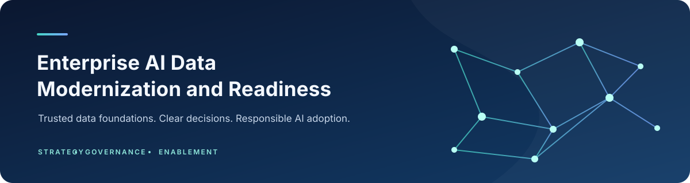

<p align="center">
  
</p>

Moving from fragmented data to a governed foundation for analytics and AI, with a clear plan for the people and decisions needed to get there.

<p>
  
  
  
  
</p>

## Program overview

This repository brings together the working materials for an enterprise data modernization program using Microsoft Fabric. It covers both sides of the work: building a reliable data foundation and helping technical teams, business partners, and executives stay aligned on why it matters.

The materials are reference designs and templates, not evidence of a completed deployment. Examples, measures, and timelines should be adapted to the organization and validated against its actual environment.

## The program narrative

1. **Understand the current state.** Data is often spread across systems, with uneven quality, ownership, and access controls. Establishing a baseline helps teams decide where to focus first.
2. **Build a shared foundation.** Microsoft Fabric and OneLake can provide a common platform for data engineering and analytics. The design still depends on deliberate choices about access, governance, and workload needs.
3. **Improve data in stages.** A medallion approach organizes work into Bronze, Silver, and Gold layers, with checks and ownership defined at each stage.
4. **Connect readiness to business use.** A scorecard can make data gaps visible and help teams decide what to address before a specific analytics or AI use case proceeds. A score alone does not establish that a dataset is safe or appropriate for production use.

## Repository map

```text
program-charter/
└── ai-data-modernization-charter.md    Program goals, scope, roles, and measures
architecture/
├── fabric-lakehouse-design.md          Fabric and OneLake design considerations
└── medallion-architecture.md           Bronze, Silver, and Gold design
notebooks/
├── README.md                           Notebook setup and expected outputs
├── 01_data_quality_assessment.ipynb    Data quality checks for Lakehouse tables
└── 02_ai_readiness_scorecard.ipynb     Example readiness assessment
executive-narratives/
├── briefing-framework.md               Repeatable briefing structure
├── cio-briefing-template.md            CIO briefing agenda and prompts
└── ai-adoption-narrative.md             Communication approach for adoption
outcomes/
└── program-results.md                  Outcome measures and reporting prompts
```

## Organizational adoption

Platform work is only part of modernization. The program materials also support:

- **Executive alignment:** connect investment decisions to business priorities, risks, and evidence.
- **Cross-functional collaboration:** give product, engineering, security, and business teams a shared vocabulary for decisions.
- **Team development:** use the notebooks and architecture examples as starting points for hands-on learning, with changes reviewed against local standards.

## Business value

A well-scoped modernization effort can make data ownership and quality gaps easier to see, reduce duplicated work where systems can be consolidated, and give teams a more consistent starting point for analytics and AI projects. The program should measure these outcomes against a documented baseline rather than assume they will occur automatically.

## Using the materials

Start with the program charter, then review the Fabric design and medallion approach. The notebooks are examples that require an attached Lakehouse and environment-specific configuration. The executive materials are templates: replace prompts with verified evidence and make each briefing's decision or request explicit.
